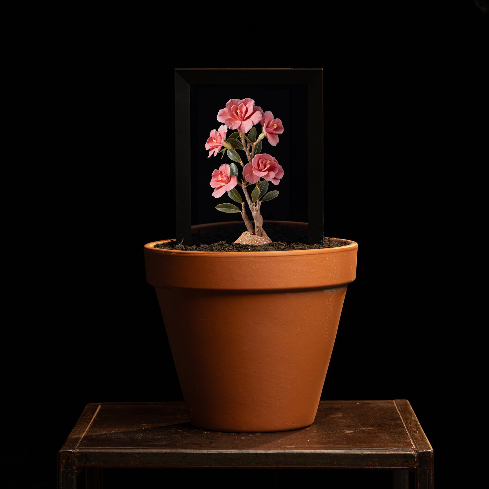
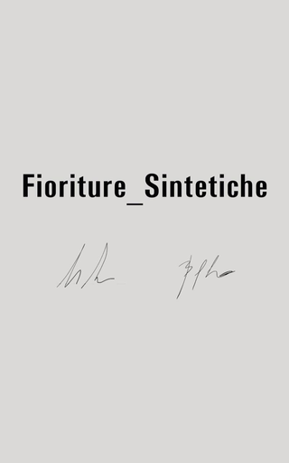
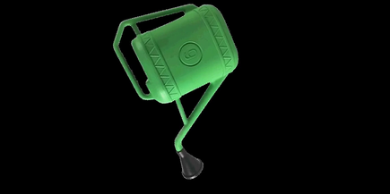

<div align="center">

# Frame Boot Animation and Image Changer

### Replace the boot logo and boot animation of Android digital photo frames



_Fioriture Sintetiche by [Matteo Mandelli](https://matteomandelli.com). [Watch the video on LinkedIn](https://lnkd.in/p/evKfwxz7)._

</div>

Step-by-step guides to change the **boot logo** and the **boot animation** on Android-based digital photo frames, such as Frameo frames, using the frame's Rockchip or Allwinner chip.

It was made for **[Fioriture Sintetiche](https://matteomandelli.com)**, an art project by Matteo Mandelli: digital frames planted in pots become synthetic flowers. The frames had to start with the artwork's own logo and animation instead of the manufacturer's branding, so the installation looks like one piece from the moment it switches on.

Working this out took a long time: the information was spread across old forum threads, tools documented only in Russian or Chinese, and firmware layouts that differ between chips. These guides collect the exact procedure that worked.

| Boot logo | Boot animation |
| :-------: | :------------: |
|  |  |

## Guides

| Guide | Chip | What changes | Method |
| ----- | ---- | ------------ | ------ |
| [Boot animation](guides/rockchip-boot-animation.md) | Rockchip | The animation shown while Android starts | Root ADB, replace `/system/media/bootanimation.zip` |
| [Boot logo](guides/rockchip-boot-logo.md) | Rockchip | The first static image after power-on | Dump firmware, edit the `resource` partition, flash it back |
| [Boot logo and animation](guides/allwinner.md) | Allwinner | Both | ADB and an on-device file manager |
| [Create your own files](guides/create-your-own.md) | Any | – | Build a valid `bootanimation.zip` and logo BMP |

Not sure which chip your frame uses? Connect it and run:

```sh
adb shell getprop ro.board.platform
```

A value starting with `rk` means Rockchip. Allwinner chips usually report a `sun…` name here or in `adb shell getprop ro.hardware`.

## Before you start

> [!WARNING]
> Flashing a partition can leave the frame unable to boot. **Back up first**: every guide starts by saving the original files, and the Rockchip logo guide dumps the whole firmware so you can restore it. You do this at your own risk.

- A Windows PC. The Rockchip tools are Windows programs.
- [Android platform-tools](https://developer.android.com/tools/releases/platform-tools) (ADB), with the frame visible in `adb devices`.
- A USB cable that carries data, not just power.

## Tools

None of these tools are included here: download them from their authors.

| Tool | Author | Used for | Download |
| ---- | ------ | -------- | -------- |
| ADB (platform-tools) | Google | Talk to the frame over USB | [developer.android.com](https://developer.android.com/tools/releases/platform-tools) |
| adbd Insecure v2.00 | Chainfire | Root access over ADB on Rockchip frames | [XDA thread](https://forum.xda-developers.com/showthread.php?t=1687590) · [chainfire.eu](https://chainfire.eu/articles/896/adbd_Insecure_updated_to_v2.00_-_Lollipop_support) |
| Rockchip DriverAssistant v5.0 | Rockchip | USB drivers for loader mode | [Radxa mirror](https://dl.radxa.com/tools/windows/DriverAssitant_v5.0.zip) |
| rkDumper 1.1.1.0 | RedScorpio | Back up the full firmware by partition | [XDA thread](https://xdaforums.com/t/tool-rkdumper-utility-for-backup-firmware-of-rockchips-devices.2915363/) |
| imgRePackerRK 1.06 | RedScorpio | Unpack and repack the `resource` image | [XDA thread](https://forum.xda-developers.com/showthread.php?t=2257331) |
| RKDevTool v2.86 | Rockchip | Flash a single partition | [Rockchip tools collection](https://github.com/vicharak-in/rockchip-linux-tools/tree/master/windows) · [Radxa mirror (v2.81)](https://dl.radxa.com/tools/windows/RKDevTool_Release_v2.81.zip) |
| ImageMagick | ImageMagick Studio | Check and convert the logo BMP | [imagemagick.org](https://imagemagick.org/script/download.php) |
| A root file manager (we used ES File Explorer) | – | Move files into system folders on Allwinner frames | Any root-capable file manager APK |

The Rockchip procedure follows the approach described in [How to backup and restore Android system on a Rockchip device](https://winstonhyypia.medium.com/how-to-backup-and-restore-android-system-on-rockchip-device-c7058098216) by Winston Hyypia.

## Examples

The [`examples`](examples) folder has the files used for Fioriture Sintetiche. They show the exact format that worked:

| File | Format |
| ---- | ------ |
| `rockchip/logo.bmp` | 800 × 1280, 24-bit BMP3 |
| `rockchip/bootanimation.zip` | 870 × 433 at 20 fps, one looping part, stored without compression |
| `allwinner/bootlogo.bmp` | 800 × 1280, 24-bit BMP, rotated 180° to match the panel |

## Credits

- **Artwork:** Fioriture Sintetiche logo and animation © [Matteo Mandelli](https://matteomandelli.com), used with permission. Not covered by the license below.
- **Tools:** Chainfire (adbd Insecure), RedScorpio (rkDumper, imgRePackerRK), Rockchip (RKDevTool, DriverAssistant) and the [XDA Developers](https://xdaforums.com) community, where these tools and much of this knowledge come from.
- **Guides:** [Davide Gaglione](https://github.com/DavideWasTaken).

## License

The guides are released under the [MIT license](LICENSE). The artwork in `examples/` and `images/` belongs to Matteo Mandelli. The third-party tools linked above keep their own terms.
